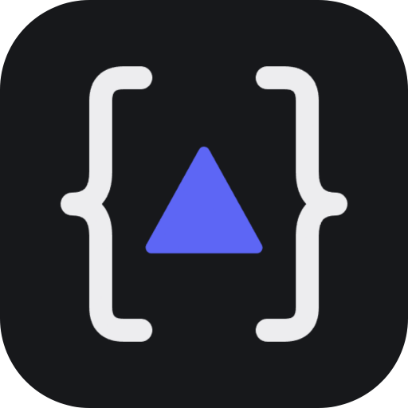

# Prism: JSON Viewer Extension

Prism is an open-source JSON viewer for Chrome. Open any JSON response in the browser and it is replaced in place by an explorer with 8 linked views. Selecting a node anywhere selects it everywhere, and the inspector on the right always shows the current selection. The same app also runs as a standalone web page where you can paste, open or fetch JSON.

**Install it from the [Chrome Web Store](https://chromewebstore.google.com/detail/json-prism/cfamdgeiglncgcibopfihlpehondankf).**

The source is on GitHub at [sums001/JSON-Visualizer](https://github.com/sums001/JSON-Visualizer). Issues and pull requests are welcome.

```bash
npm install
npm run build:ext   # Chrome extension in dist-extension/ (see below)
npm run dev         # web app at http://localhost:5173
npm run build       # web app as a static site in dist/
```

Load data by pasting, opening a file, dragging a file anywhere, or fetching a URL. The paste box validates as you type and points at the line of any error. JSON Lines files work too. Deep links: `?sample=markets|missions|tokens&view=<id>&theme=dark|light`.

**Download** in the top bar saves the whole document as indented JSON, and the inspector's Download saves just the selected object or array.

Dark and light themes are both available; the sun/moon button switches between them and the choice is remembered.

| Group | View | Answers |
|---|---|---|
| Visualization | Raw | Highlighted source with folding, synced to the selection. Every document opens here |
| | Tree, Radial | How is it nested? Animated, collapsible hierarchy |
| | Graph | Force-directed network. Arrays show 24 items ("Per list"), the rest fold into a clickable `+N` node |
| | Cards | Open objects one card at a time, linked by connectors |
| Structural | Schema | Array items merged into one inferred shape, with presence %, mixed types and value profiles |
| | Table | Any array of objects as a sortable, filterable grid (CSV export) |
| | Columns | Finder-style drill-down |

Long arrays are windowed: Tree, Radial and Cards show 20 items at a time with "▲ earlier / ▼ more" pagers. Jumping to an item deep in a list (search, inspector) slides the window to it instead of growing the list. Objects show up to 60 keys before paging.

Keys: `/` or `Ctrl/⌘ K` search · `1`–`8` switch view · `]` toggle the inspector · `Ctrl/⌘ S` download the document as JSON · `?` list every shortcut · arrow keys walk the tree (parent, child, siblings).

## Chrome extension

The published extension is [JSON Prism on the Chrome Web Store](https://chromewebstore.google.com/detail/json-prism/cfamdgeiglncgcibopfihlpehondankf). To build and load it from source instead:

```bash
npm run build:ext   # unpacked extension in dist-extension/
```

Load it from `chrome://extensions` → Developer mode → **Load unpacked** → `dist-extension`. Any page served as JSON (`application/json`, `*+json`, ndjson), or plain text that parses as a JSON object or array, opens in Prism in place. **Original** in the top bar shows the browser's own view, and a button there brings Prism back. Responses that turn out not to be valid JSON are left as they are. On any other page the toolbar button opens Prism in a tab of its own. For local `.json` files, turn on "Allow access to file URLs" in the extension's details.

Settings (right-click the toolbar button → **Options**, or the sliders button in Prism's top bar):

- **When a page is JSON**: *Open in Prism* (default) replaces the response straight away. *Highlight the toolbar button* leaves the response alone and puts a `JSON` badge on the button; clicking it opens that page in Prism.
- **Detect JSON sent as plain text**: on by default.
- **Open responses in**: the first view a response shows (Raw by default).
- **Theme**: light or dark, shared with the viewer.

The first three are kept in `chrome.storage.sync`; the theme is the app's own `localStorage` choice.

`extension/` holds the manifest, the content script and the service worker. The build copies them next to the app, adds the settings page (`options.html`, `src/options/`) as a second page, and takes the manifest's version from `package.json`. The content script covers the response with a frame of the built app (`index.html?embed`) and posts it the response text. `src/lib/embed.js` is the app's side of that exchange.

## Code map

- `src/prism-tokens.css`: the design tokens (surfaces, text, accent, the six JSON type colours, type scale, spacing, radius) for both themes. Every other stylesheet uses only these variables, and the graph canvas reads them through `palette()` in `src/lib/colors.js`
- `public/`: the logo. `prism-logo-*.png` are the favicon and app icons; `prism-mark-on-dark|light-512.png` is the in-app mark, swapped with the theme
- `src/components/common.jsx`: shared pieces, including `BrandMark`, `ViewFrame` (each view's title bar, canvas and hint strip), type badges and the node tooltip
- `src/lib/model.js`: flattens JSON into an indexed node tree (paths, sizes, counts) shared by every view
- `src/lib/schema.js`: generalises `[n]` to `[*]` for schema inference, finds record arrays, profiles columns
- `src/store.js`: zustand store for selection, expansion, focus, search and the record-set choice
- `src/views/*`: one component per view, registered in `src/views/index.js`

## Contributing

Prism is open source and contributions are welcome: bug reports, JSON files that render badly, new views, or fixes.

1. Fork [the repository](https://github.com/sums001/JSON-Visualizer) and create a branch.
2. `npm install`, then `npm run dev` to work on the app, or `npm run build:ext` and reload the unpacked extension to test it in Chrome.
3. Keep styles on the design tokens in `src/prism-tokens.css` and check both the dark and light themes.
4. Open a pull request describing the change, with a screenshot for anything visual.
