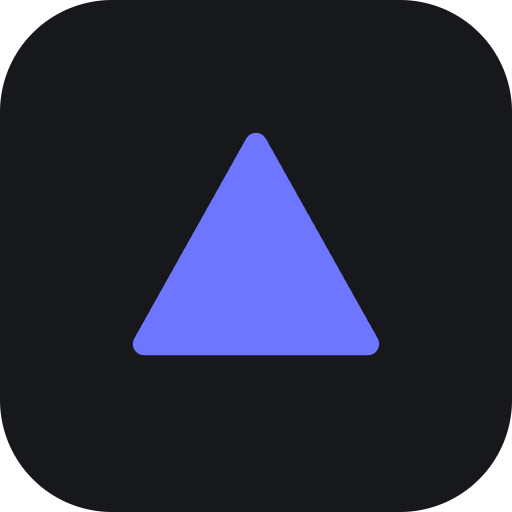

# Prism: JSON Explorer

Drop in any JSON and explore it through 8 linked views. Selecting a node anywhere selects it everywhere, and the inspector on the right always shows the current selection.

```bash
npm install
npm run dev      # http://localhost:5173
npm run build    # static site in dist/
```

Load data by pasting, opening a file, dragging a file anywhere, or fetching a URL. The paste box validates as you type and points at the line of any error. JSON Lines files work too. Deep links: `?sample=markets|missions|tokens&view=<id>&theme=dark|light`.

**Download** in the top bar saves the whole document as indented JSON, and the inspector's Download saves just the selected object or array.

Dark and light themes are both available; the sun/moon button switches between them and the choice is remembered.

| Group | View | Answers |
|---|---|---|
| Visualization | Tree, Radial | How is it nested? Animated, collapsible hierarchy |
| | Graph | Force-directed network. Arrays show 24 items ("Per list"), the rest fold into a clickable `+N` node |
| | Cards | Open objects one card at a time, linked by connectors |
| Structural | Schema | Array items merged into one inferred shape, with presence %, mixed types and value profiles |
| | Table | Any array of objects as a sortable, filterable grid (CSV export) |
| | Columns | Finder-style drill-down |
| | Raw | Highlighted source with folding, synced to the selection |

Long arrays are windowed: Tree, Radial and Cards show 20 items at a time with "▲ earlier / ▼ more" pagers. Jumping to an item deep in a list (search, inspector) slides the window to it instead of growing the list. Objects show up to 60 keys before paging.

Keys: `/` or `Ctrl/⌘ K` search · `1`–`8` switch view · `]` toggle the inspector · `Ctrl/⌘ S` download the document as JSON · `?` list every shortcut · arrow keys walk the tree (parent, child, siblings).

## Code map

- `src/prism-tokens.css`: the design tokens (surfaces, text, accent, the six JSON type colours, type scale, spacing, radius) for both themes. Every other stylesheet uses only these variables, and the graph canvas reads them through `palette()` in `src/lib/colors.js`
- `public/`: the logo. `prism-icon-*.png` are the favicon and app icons; `prism-mark-on-dark|light-512.png` is the in-app mark, swapped with the theme
- `src/components/common.jsx`: shared pieces, including `BrandMark`, `ViewFrame` (each view's title bar, canvas and hint strip), type badges and the node tooltip
- `src/lib/model.js`: flattens JSON into an indexed node tree (paths, sizes, counts) shared by every view
- `src/lib/schema.js`: generalises `[n]` to `[*]` for schema inference, finds record arrays, profiles columns
- `src/store.js`: zustand store for selection, expansion, focus, search and the record-set choice
- `src/views/*`: one component per view, registered in `src/views/index.js`
